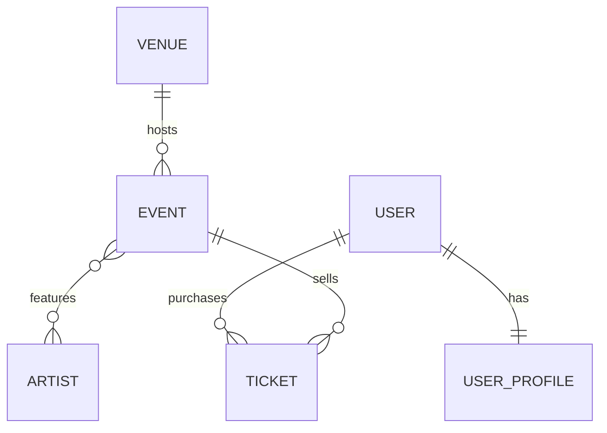

# PulsePass — capa de persistencia

Plataforma de eventos, artistas y entradas. Este repositorio implementa el MVP
académico definido en los PRD de PulsePass. Las secciones 1 a 8 documentan la
**capa de persistencia** (Fase 1); al final se documentan la **capa de
controladores REST** (Fase 3) y la **capa de seguridad** (Fase 4).

El recorrido que cubre la capa de persistencia es:

```
Modelo de negocio (PRD)
        ↓
Modelo relacional
        ↓
Flyway  (V1, V2, V3)
        ↓
PostgreSQL
        ↑
Hibernate / JPA
        ↑
Spring Data JPA
        ↑
Repository
        ↑
 ┌──────┼───────────┐
CRUD   Query       @Query
       Methods       ↓
                   JPQL
```

---

## 1. Stack

| Componente | Versión |
|---|---|
| Java | 21 |
| Spring Boot | 4.1.1 |
| Build | Maven |
| ORM | Spring Data JPA / Hibernate |
| Base de datos | PostgreSQL |
| Migraciones | Flyway |
| Pruebas | JUnit 5, AssertJ, Testcontainers |

Restricciones respetadas (sección 13 del PRD): Flyway es el único responsable
del esquema, `ddl-auto=validate`, PostgreSQL real vía Testcontainers, **sin H2**,
**sin SQL nativo** en los repositories y **sin Lombok `@Data`** sobre entidades.

---

## 2. Modelo de datos

```
Venue 1 ───── N Event
Event N ───── M Artist        (tabla asociativa event_artists)
User  1 ───── 1 UserProfile
User  1 ───── N Ticket
Event 1 ───── N Ticket
```



### Tablas

| Tabla | Tipo | Notas |
|---|---|---|
| `venues` | entidad | `UNIQUE(code)`, `CHECK (capacity > 0)` |
| `events` | entidad | `UNIQUE(event_code)`, FK a `venues`, CHECK de categoría y estado |
| `artists` | entidad | `UNIQUE(stage_name)` |
| `event_artists` | **asociativa** | PK compuesta `(event_id, artist_id)` |
| `users` | entidad | `UNIQUE(username)`, `UNIQUE(email)` |
| `user_profiles` | entidad | FK **+ `UNIQUE(user_id)`** → garantiza el 1:1 |
| `tickets` | entidad | `UNIQUE(ticket_code)`, `CHECK (price >= 0)`, dos FK |

### Dónde vive cada FK y quién es el propietario de la relación

| Relación | FK física | Propietario JPA | Lado inverso |
|---|---|---|---|
| Venue 1:N Event | `events.venue_id` | `Event` (`@ManyToOne` + `@JoinColumn`) | `Venue.events` (`mappedBy = "venue"`) |
| Event N:M Artist | `event_artists` | `Event` (`@ManyToMany` + `@JoinTable`) | `Artist.events` (`mappedBy = "artists"`) |
| User 1:1 UserProfile | `user_profiles.user_id` | `UserProfile` (`@OneToOne` + `@JoinColumn`) | `User.profile` (`mappedBy = "user"`) |
| User 1:N Ticket | `tickets.user_id` | `Ticket` | `User.tickets` |
| Event 1:N Ticket | `tickets.event_id` | `Ticket` | `Event.tickets` |

El propietario es siempre el lado que mantiene físicamente la FK.

### Tres decisiones de modelado

**Por qué `Ticket` es una entidad y no un `@ManyToMany` entre `User` y `Event`.**
Una tabla asociativa pura solo guarda el par de FK. Un ticket tiene datos
propios — `ticketCode`, `type`, `price`, `status`, `purchaseDate` — y no habría
dónde ponerlos (BR-006).

**Por qué `UNIQUE(user_id)` en `user_profiles`.** La FK sola produce una relación
1:N: nada impediría insertar dos perfiles para el mismo usuario. Es el `UNIQUE`
el que convierte la relación en un 1:1 real dentro de PostgreSQL (BR-004).

**Por qué PK compuesta en `event_artists`.** Sin ella se podría insertar dos
veces el par `(CMF-2026, Solar Beat)`, y las consultas por artista devolverían
el mismo evento repetido (AC-003).

---

## 3. Migraciones Flyway

| Archivo | Contenido |
|---|---|
| `V1__create_schema.sql` | Las 7 tablas con PK, FK, UNIQUE, CHECK e índices |
| `V2__insert_initial_artists.sql` | Catálogo: Solar Beat, Neon Waves, Caribbean Sound, Ocean Drive, Digital Pulse |
| `V3__add_streaming_url_to_event.sql` | `streaming_url VARCHAR(500)` nullable en `events` |

**Por qué `ddl-auto=validate` y no `update`.** Con `update` Hibernate deduce el
esquema del mapeo Java y lo modifica en caliente: nunca se sabe con certeza qué
estructura tiene la base, los cambios no quedan versionados y no hay forma de
reproducir el esquema desde cero. Con `validate`, Flyway crea el esquema e
Hibernate solo comprueba que su mapeo coincida; si algo no cuadra, la aplicación
**no arranca**. El error aparece al inicio y no en producción.

**Por qué V3 en lugar de editar V1.** Flyway guarda un checksum de cada
migración en `flyway_schema_history`. Editar V1 después de haberla aplicado hace
que el checksum deje de coincidir y Flyway falle en todo entorno donde ya se
ejecutó; quien tenga la base vieja nunca recibiría el cambio. El esquema se
evoluciona siempre hacia adelante (NFR-002, pregunta 4 del PRD).

---

## 4. Consultas implementadas

### Métodos heredados de `JpaRepository`

`save`, `saveAll`, `saveAndFlush`, `findById`, `findAll`, `existsById`, `count`,
`delete`, `deleteById`, `flush`.

### Query Methods

| Repository | Método | Requisito |
|---|---|---|
| `VenueRepository` | `findByCode` | FR-VEN-001 |
| | `findByCityIgnoreCase` | — |
| | `findByActiveTrueOrderByNameAsc` | — |
| | `findByCapacityGreaterThanEqualOrderByCapacityDesc` | — |
| `EventRepository` | `findByEventCode` | FR-EVT-002 |
| | `findByStatusOrderByEventDateAsc` | FR-EVT-005 |
| | `findByCategoryAndStatusOrderByEventDateAsc` | — |
| | `findByStatusAndEventDateAfterOrderByEventDateAsc` | — |
| | `findByNameContainingIgnoreCaseOrderByEventDateAsc` | — |
| | `findByVenueCodeOrderByEventDateAsc` | **FR-VEN-004** (navega relación) |
| | `findByVenueCityIgnoreCaseOrderByEventDateAsc` | navega relación |
| | `findByVenueCityIgnoreCaseAndStatusOrderByEventDateAsc` | navega relación |
| `ArtistRepository` | `findByStageNameIgnoreCase` | FR-ART-002 |
| | `findByActiveTrueOrderByStageNameAsc` | — |
| | `findByStageNameContainingIgnoreCaseOrderByStageNameAsc` | — |
| `UserRepository` | `findByEmailIgnoreCase` | FR-USR-002 |
| | `findByUsername` | FR-USR-002 |
| | `findByActiveTrueOrderByUsernameAsc` | — |
| | `existsByEmailIgnoreCase` | — |
| `UserProfileRepository` | `findByUserId` | FR-USR-003 |
| | `findByUserEmailIgnoreCase` | **FR-USR-004** (navega relación) |
| | `findByCityIgnoreCaseOrderByLastNameAsc` | — |
| `TicketRepository` | `findByTicketCode` | FR-TKT-002 |
| | `findByUserEmailIgnoreCaseOrderByPurchaseDateDesc` | **FR-TKT-006** (navega relación) |
| | `findByUserEmailIgnoreCaseAndStatusOrderByPurchaseDateDesc` | FR-TKT-006 |
| | `findByEventEventCodeAndStatusOrderByPurchaseDateAsc` | **FR-TKT-007** |
| | `findByEventEventCodeAndTypeAndStatus` | — |

Cómo leer `findByUserEmailIgnoreCaseOrderByPurchaseDateDesc`:

```
Ticket
  ↓ user
User
  ↓ email        (ignorando mayúsculas)
       ordenado por Ticket.purchaseDate descendente
```

Spring Data no encuentra una propiedad `userEmail` en `Ticket`, así que parte el
nombre y resuelve `user.email`. Si el nombre resultara ambiguo, puede forzarse el
corte con un guion bajo: `findByUser_EmailIgnoreCase...`.

### Consultas JPQL (`@Query`)

| Repository | Método | Requisito | Por qué JPQL |
|---|---|---|---|
| `ArtistRepository` | `findArtistsByEventCode` | FR-ART-003 | recorre la N:M en sentido inverso |
| `EventRepository` | `findEventsByArtistStageName` | FR-SRC-001 / AC-007 | `JOIN` sobre N:M + `DISTINCT` |
| | `findEventsByCityAndArtist` | FR-SRC-002 | dos asociaciones distintas |
| | `findRecommendedEvents` | FR-SRC-003 | cuatro filtros, `LIKE`, `DISTINCT` y orden |
| | `findByEventCodeWithArtists` | — | `JOIN FETCH` contra el problema N+1 |
| `TicketRepository` | `countTicketsByEventCodeAndStatus` | FR-TKT-008 / AC-008 | `COUNT` en la base |
| | `findTicketsOfUpcomingEvents` | FR-SRC-004 | ordena por atributo de la entidad asociada |
| | `findTicketsByUserEmailAndCity` | — | recorre tres entidades |

**Por qué JPQL escribe `Event` y no `events`.** JPQL consulta el **modelo de
objetos**, no las tablas: sus nombres son los de las entidades y sus atributos
Java. Hibernate traduce después a SQL usando el mapeo. Por eso
`join e.artists a` no menciona nunca `event_artists`, aunque el SQL generado sí
la use.

**Criterio para elegir el mecanismo.**

```
¿Ya existe en JpaRepository?  ──sí──>  método heredado
              │no
              ▼
¿Consulta simple sobre atributos
 o un camino de navegación corto? ──sí──>  Query Method
              │no
              ▼
   varias asociaciones, JOIN,
   DISTINCT, COUNT o LIKE      ────────>  @Query + JPQL
```

---

## 5. Pruebas

47 pruebas de integración contra PostgreSQL real levantado por Testcontainers.

| Clase | Pruebas | Cubre |
|---|---:|---|
| `FlywayMigrationIT` | 6 | QT-001, QT-002 — Flyway aplica V1/V2/V3 y Hibernate solo valida |
| `VenuePersistenceTest` | 5 | FR-VEN-001..003, AC-001, QT-009 |
| `EventRepositoryIT` | 7 | QT-003, FR-EVT-001..006, FR-VEN-004, AC-002, AC-006 |
| `EventArtistIT` | 5 | QT-005, FR-ART-003/004, AC-003, AC-007 |
| `UserProfileIT` | 5 | QT-004, FR-USR-001..004, AC-004 |
| `TicketRepositoryIT` | 9 | QT-006, FR-TKT-001..008, AC-005 |
| `EventSearchIT` | 9 | escenario de referencia (§16), FR-SRC-001..004, AC-008 |

**Por qué Testcontainers y no H2.** H2 imita PostgreSQL, no lo reproduce. Un
`CHECK (capacity > 0)`, el comportamiento exacto de `NUMERIC(12,2)`, el orden de
un `ORDER BY` bajo la colación real o el mensaje de una violación de UNIQUE
pueden comportarse distinto. Probar contra H2 y desplegar contra PostgreSQL es
probar otra cosa (NFR-005).

**Por qué probar los constraints contra la base y no solo en Java.** Una
validación en Java protege un único camino de escritura. El `CHECK` y el `UNIQUE`
protegen la tabla frente a cualquier cliente — otra aplicación, un script, una
carga manual. Por eso `VenuePersistenceTest` comprueba que PostgreSQL rechace una
capacidad de cero, en lugar de confiar en la entidad.

**Un solo contenedor para todas las clases.** `PostgresContainerConfiguration`
declara el contenedor como `@Bean` con `@ServiceConnection` en vez de usar un
campo estático con `@Container`. Spring lo arranca y lo detiene con el contexto,
y como el contexto se cachea entre clases, las 7 comparten el mismo contenedor
en lugar de levantar uno por clase.

---

## 6. Cómo ejecutar

### Requisitos

- JDK 21
- Maven 3.9+
- Docker en ejecución (Testcontainers lo necesita; no hace falta instalar PostgreSQL)

### Pruebas

```bash
mvn clean test
```

Resultado esperado: `BUILD SUCCESS` (QT-010).

Mientras corren, en otra terminal:

```bash
docker ps
```

Debe aparecer temporalmente un contenedor `postgres:18-alpine` creado por
Testcontainers.

> **Nota sobre Surefire.** Por defecto Surefire solo ejecuta las clases que
> terminan en `Test`, `Tests` o `TestCase`, de modo que las clases `*IT`
> quedarían fuera y `mvn clean test` daría `BUILD SUCCESS` **sin haberlas
> corrido**. El `pom.xml` agrega `**/*IT.java` a los `includes` para que el
> resultado signifique lo que dice.

### Aplicación contra un PostgreSQL propio

```bash
createdb pulsepass

DB_URL=jdbc:postgresql://localhost:5432/pulsepass \
DB_USER=postgres \
DB_PASSWORD=postgres \
mvn spring-boot:run
```

Flyway aplica V1, V2 y V3 al arrancar; Hibernate valida el esquema resultante.

> **Desde la Fase 4** la aplicación también necesita la variable de entorno
> `PULSEPASS_JWT_SECRET_BASE64`; sin ella no arranca. Ver la sección
> "Capa de seguridad (Fase 4)" al final de este documento.

### Qué mirar en los logs

1. Flyway ejecutando `V1`, `V2` y `V3`.
2. Hibernate **validando** el esquema — nunca creándolo.

---

## 7. Estructura

```
pulsepass/
├── pom.xml
├── README.md
└── src
    ├── main
    │   ├── java/com/pulsepass
    │   │   ├── PulsePassApplication.java
    │   │   ├── domain
    │   │   │   ├── Venue.java
    │   │   │   ├── Event.java          EventCategory.java  EventStatus.java
    │   │   │   ├── Artist.java
    │   │   │   ├── User.java           UserProfile.java
    │   │   │   └── Ticket.java         TicketType.java     TicketStatus.java
    │   │   └── repository
    │   │       ├── VenueRepository.java        EventRepository.java
    │   │       ├── ArtistRepository.java       UserRepository.java
    │   │       ├── UserProfileRepository.java  TicketRepository.java
    │   └── resources
    │       ├── application.yml
    │       └── db/migration
    │           ├── V1__create_schema.sql
    │           ├── V2__insert_initial_artists.sql
    │           └── V3__add_streaming_url_to_event.sql
    └── test/java/com/pulsepass
        ├── support
        │   ├── PostgresContainerConfiguration.java
        │   ├── AbstractPersistenceIT.java
        │   └── TestFixtures.java
        └── repository
            ├── FlywayMigrationIT.java      VenuePersistenceTest.java
            ├── EventRepositoryIT.java      EventArtistIT.java
            ├── UserProfileIT.java          TicketRepositoryIT.java
            └── EventSearchIT.java
```

---

## 8. Definition of Done (sección 21 del PRD)

- [x] El modelo relacional implementa todas las entidades y relaciones del MVP
- [x] Las migraciones reconstruyen el esquema desde cero
- [x] Hibernate opera en modo `validate`
- [x] Todos los repositories necesarios existen y usan `JpaRepository`
- [x] Cada requisito de consulta tiene implementación y prueba
- [x] Los constraints críticos se validan contra PostgreSQL
- [x] Las pruebas de integración usan Testcontainers
- [x] `mvn clean test` finaliza sin errores
- [x] El README explica modelo, migraciones, consultas y ejecución

## Capa de controladores REST (Fase 3)

API REST que expone los Services de las fases anteriores mediante HTTP. Los Controllers solo traducen HTTP: reciben el pedido, delegan en el Service y devuelven un DTO. Las reglas de negocio permanecen en la capa Service, ningún Controller usa un Repository y ningún endpoint devuelve entidades JPA.

### Endpoints

| Recurso | Método | Endpoint | Respuesta |
|---|---|---|---|
| Venues | GET | `/api/venues/{code}` | 200 / 404 |
| Venues | GET | `/api/venues/active` | 200 |
| Eventos | POST | `/api/events` | 201 / 400 |
| Eventos | GET | `/api/events/{eventCode}` | 200 / 404 |
| Eventos | GET | `/api/events/published` | 200 |
| Eventos | PATCH | `/api/events/{eventCode}/publish` | 200 / 409 |
| Eventos | POST | `/api/events/{eventCode}/artists/{artistId}` | 200 / 409 |
| Eventos | GET | `/api/events/by-artist?stageName=...` | 200 |
| Artistas | GET | `/api/artists/{id}` | 200 / 404 |
| Artistas | GET | `/api/artists/by-stage-name?stageName=...` | 200 / 404 |
| Artistas | GET | `/api/artists/active` | 200 |
| Usuarios | POST | `/api/users` | 201 / 400 / 409 |
| Usuarios | GET | `/api/users/by-email?email=...` | 200 / 404 |
| Usuarios | GET | `/api/users/by-username?username=...` | 200 / 404 |
| Tickets | POST | `/api/tickets` | 201 / 400 / 404 / 409 |
| Tickets | GET | `/api/tickets/{ticketCode}` | 200 / 404 |
| Tickets | GET | `/api/tickets/by-user?email=...` | 200 |
| Tickets | GET | `/api/events/{eventCode}/tickets/paid` | 200 |
| Tickets | PATCH | `/api/tickets/{ticketCode}/cancel` | 200 / 409 |
| Tickets | PATCH | `/api/tickets/{ticketCode}/use` | 200 / 409 |

### Manejo de errores

`GlobalExceptionHandler` (`@RestControllerAdvice`) convierte las excepciones en un `ErrorResponse` con el formato `timestamp`, `status`, `error`, `message` y `details`.

| Condición | Código HTTP |
|---|---|
| Bean Validation falla o JSON mal formado | 400 |
| `ResourceNotFoundException` | 404 |
| `DuplicateResourceException` | 409 |
| `BusinessRuleException` | 409 |
| Error inesperado | 500 |

### Pruebas de los Controllers

Usan `@WebMvcTest`, MockMvc y los Services simulados con `@MockitoBean`, así que no necesitan base de datos ni Docker. Hay 33 pruebas, en `src/test/java/com/pulsepass/controller`:

```
.\mvnw test -Dtest="*ControllerTest"
```

Si el proyecto no incluye el wrapper `mvnw`, se pueden correr desde el IDE con clic derecho sobre la carpeta `controller` de `test` y **Run**.

## Capa de seguridad (Fase 4)

Autenticación con usuario o correo y contraseña, emisión de **JWT firmado (HS256, JJWT 0.13)** de 15 minutos, autorización por rol con **Spring Security** y control de propiedad de los recursos. La API es **stateless**: no usa sesiones ni cookies, solo el encabezado `Authorization: Bearer <token>`.

Las reglas de negocio de las fases anteriores no cambian. Los 20 endpoints conservan su URL, su verbo y su respuesta exitosa; la seguridad se agrega encima.

### Variables de entorno

| Variable | Obligatoria | Por defecto | Descripción |
|---|---|---|---|
| `PULSEPASS_JWT_SECRET_BASE64` | **Sí** | ninguno | Clave HMAC en Base64 con **al menos 32 bytes**. Si falta o es más corta, la aplicación **no arranca**. |
| `PULSEPASS_JWT_ISSUER` | No | `pulsepass-api` | Emisor que se escribe en cada token y se exige al validarlo. |
| `DB_URL`, `DB_USER`, `DB_PASSWORD` | No | PostgreSQL local | Igual que en la Fase 1. |

La duración del token (`PT15M`, 900 segundos) se configura en `application.yml`, en `pulsepass.security.jwt.access-token-ttl`.

La clave **no** se escribe en el código ni en `application.yml`, y no debe subirse a GitHub. Para generar una (Windows):

```
powershell -Command "$b = New-Object byte[] 32; [Security.Cryptography.RandomNumberGenerator]::Create().GetBytes($b); [Convert]::ToBase64String($b)"
```

En Linux o macOS: `openssl rand -base64 32`. Para usarla en la ventana actual de CMD:

```
set PULSEPASS_JWT_SECRET_BASE64=<la clave generada>
mvn spring-boot:run
```

Desde IntelliJ, se define en **Run > Edit Configurations > Environment variables**.

Las pruebas **no** necesitan esa variable: usan una clave ficticia, exclusiva de los tests, en `src/test/resources/application.properties`.

### Endpoints nuevos y cambios de contrato

| Método | Ruta | Acceso | Resultado |
|---|---|---|---|
| POST | `/api/auth/login` | Público | 200 con `accessToken`, `tokenType` y `expiresIn` / 401 / 400 |
| GET | `/api/auth/me` | Autenticado | 200 con `userId`, `username` y `roles` / 401 |
| POST | `/api/users` | Público | **Ahora exige `password`** (12 a 72 caracteres y máximo 72 bytes). Crea siempre el rol `USER`. |

```
POST /api/auth/login
Content-Type: application/json

{ "identifier": "andrea", "password": "<la contraseña>" }
```

```
200 OK
{ "accessToken": "<JWT>", "tokenType": "Bearer", "expiresIn": 900 }
```

```
GET /api/auth/me
Authorization: Bearer <JWT>
```

El `identifier` puede ser el username o el correo. El registro no devuelve token: el flujo es **registro, luego login**. `UserResponse` nunca incluye la contraseña ni el hash.

### Roles

| Rol | Para qué |
|---|---|
| `USER` | Comprar tickets y consultar o cancelar los suyos. Es el único rol que se obtiene al registrarse. |
| `STAFF` | Operar la entrada: ver tickets y marcarlos como usados; ver tickets pagados de un evento y eventos no publicados. |
| `ADMIN` | Crear y publicar eventos, asociar artistas y consultar datos de otros usuarios. |

Los roles `STAFF` y `ADMIN` **no se piden por HTTP**: se asignan en la base de datos. Para una cuenta de prueba local, primero se registra el usuario con `POST /api/users` y luego:

```sql
INSERT INTO user_roles (user_id, role)
SELECT id, 'ADMIN' FROM users WHERE username = 'admin1';
```

Los roles se leen de la base de datos en **cada solicitud**; no viajan dentro del token. Por eso un cambio de rol o la desactivación de un usuario surte efecto de inmediato, aunque su token siga sin vencer.

### Quién puede usar cada una de las 20 operaciones

| Recurso | Método y ruta | Acceso |
|---|---|---|
| Venues | `GET /api/venues/{code}` | Público |
| Venues | `GET /api/venues/active` | Público |
| Eventos | `POST /api/events` | `ADMIN` |
| Eventos | `GET /api/events/{eventCode}` | Público si está publicado. Cualquier otro estado: solo `STAFF` y `ADMIN`; para los demás responde 404. |
| Eventos | `GET /api/events/published` | Público |
| Eventos | `PATCH /api/events/{eventCode}/publish` | `ADMIN` |
| Eventos | `POST /api/events/{eventCode}/artists/{artistId}` | `ADMIN` |
| Eventos | `GET /api/events/by-artist?stageName=...` | Público y `USER`: solo eventos publicados. `STAFF` y `ADMIN`: todos. |
| Artistas | `GET /api/artists/{id}` | Público |
| Artistas | `GET /api/artists/by-stage-name?stageName=...` | Público |
| Artistas | `GET /api/artists/active` | Público |
| Usuarios | `POST /api/users` | Público |
| Usuarios | `GET /api/users/by-email?email=...` | El propio usuario o `ADMIN` |
| Usuarios | `GET /api/users/by-username?username=...` | El propio usuario o `ADMIN` |
| Tickets | `POST /api/tickets` | `USER`; el `userEmail` debe ser el del usuario autenticado |
| Tickets | `GET /api/tickets/{ticketCode}` | El dueño, `STAFF` o `ADMIN` |
| Tickets | `GET /api/tickets/by-user?email=...` | El propio usuario o `ADMIN` |
| Tickets | `GET /api/events/{eventCode}/tickets/paid` | `STAFF` o `ADMIN` |
| Tickets | `PATCH /api/tickets/{ticketCode}/cancel` | El dueño o `ADMIN` (se comprueba antes de cambiar el estado) |
| Tickets | `PATCH /api/tickets/{ticketCode}/use` | `STAFF` o `ADMIN` |

Las rutas que no aparecen en `SecurityConfig` exigen estar autenticado: la política es **denegar por defecto**.

### Códigos de error de seguridad

| Caso | HTTP |
|---|---|
| Sin token, token vencido, alterado, de otro emisor o mal formado | 401 |
| Contraseña incorrecta, usuario inexistente o usuario inactivo en el login | 401, siempre con el mismo mensaje |
| Usuario autenticado sin el rol necesario | 403 |
| Ticket o datos de usuario de otra persona | 403 |
| Evento no publicado visto por quien no es `STAFF` ni `ADMIN` | 404, igual que si no existiera |

Todos usan el mismo `ErrorResponse` (`timestamp`, `status`, `error`, `message`, `details`). Los errores 401 y 403 que ocurren en el filtro, antes de llegar a los controladores, se escriben con `SecurityErrorWriter`; los que ocurren dentro de un servicio los maneja `GlobalExceptionHandler`.

### Base de datos

`V4__security_credentials_roles.sql` crea `user_credentials` (hash BCrypt, relación 1:1 con `users`) y `user_roles` (clave primaria compuesta y `CHECK` que solo admite `USER`, `STAFF` y `ADMIN`). Los usuarios que ya existían reciben el rol `USER` y **no tienen contraseña**, así que no pueden iniciar sesión hasta una activación segura; no se asigna ninguna contraseña por defecto.

### Cambios sobre las fases anteriores

- `RegisterUserRequest` incorpora el campo `password`.
- `UserController.register` pasa por `AuthService`, para crear usuario, hash y rol en una sola transacción.
- `TicketService`, `UserService` y `EventService` llevan reglas `@PreAuthorize` y `@PostFilter` que usan `AuthorizationService`.
- `GlobalExceptionHandler` agrega el manejo de `AccessDeniedException` como 403.
- `EventServiceImpl.findByArtist` devuelve una lista modificable, para que el filtro de seguridad pueda recortarla.

### Pruebas de la Fase 4

| Clase | Pruebas | Tipo | Cubre |
|---|---:|---|---|
| `JwtServiceTest` | 18 | unitaria | firma, claims, vencimiento, emisor, token manipulado, sin firma, clave débil |
| `AuthServiceTest` | 7 | unitaria | login correcto, credenciales inválidas, usuario inactivo, hash y rol en el registro |
| `CustomUserDetailsServiceTest` | 8 | unitaria | usuario existente, inexistente, sin credencial, inactivo, roles actualizados |
| `AuthorizationServiceTest` | 20 | unitaria | dueño contra tercero, correos ajenos, STAFF, ADMIN, visibilidad de eventos |
| `JwtAuthenticationFilterTest` | 11 | unitaria | sin Bearer, Bearer válido e inválido, doble encabezado, autenticación existente |
| `SecurityFlowIT` | 23 | integración (MockMvc, cadena de filtros real) | 401 y 403, tokens inválidos, roles, usuario desactivado |
| `TicketOwnershipIT` | 11 | integración | compra, consulta, cancelación y uso de tickets ajenos |
| `EventVisibilityIT` | 9 | integración | borradores ocultos, búsqueda por artista |
| `CredentialPersistenceIT` | 9 | integración | migración V4, hash BCrypt, unicidad de roles, login con un usuario real |

Las pruebas de integración usan PostgreSQL real con Testcontainers y no desactivan los filtros de seguridad. Todas las contraseñas, hashes y claves de las pruebas son ficticios.

### Cómo verificar

Con Docker en ejecución:

```
mvn clean test
```

Resultado esperado: `BUILD SUCCESS`. Para correr solo las pruebas de seguridad de integración:

```
mvn test -Dtest="SecurityFlowIT,TicketOwnershipIT,EventVisibilityIT,CredentialPersistenceIT"
```

Si no hay Maven instalado, se corren desde IntelliJ: panel **Maven > pulsepass > Lifecycle > test**.

### Estructura agregada

```
src/main/java/com/pulsepass
├── controller/AuthController.java
├── domain/            Role.java  UserCredential.java  UserRole.java
├── dto/request/       LoginRequest.java
├── dto/response/      AuthResponse.java  AuthenticatedUserResponse.java
├── repository/        UserCredentialRepository.java  UserRoleRepository.java
├── service/           AuthService.java  AuthorizationService.java
└── security/          SecurityConfig.java  JwtProperties.java  JwtService.java
                       JwtAuthenticationFilter.java  CustomUserDetailsService.java
                       SecurityPrincipal.java  SecurityErrorWriter.java
                       RestAuthenticationEntryPoint.java  RestAccessDeniedHandler.java
src/main/resources/db/migration/V4__security_credentials_roles.sql
src/test/resources/application.properties        (clave JWT ficticia, solo para pruebas)
```

### Limitaciones conocidas

Esta fase es un MVP académico. **No** implementa, y no debe presentarse como implementado:

- Refresh tokens, cierre de sesión con revocación de tokens, ni revocación individual por `jti`. Cerrar sesión en el cliente solo borra su copia: un token ya emitido sigue siendo válido hasta vencer (15 minutos), aunque un usuario desactivado es rechazado en la solicitud siguiente.
- Límite de intentos de login ni protección contra fuerza bruta.
- MFA, recuperación de contraseña, OAuth2 ni proveedor externo de identidad.
- Rotación de la clave de firma. Se usa una clave simétrica compartida por una sola aplicación.
- Asignación de `STAFF` a eventos concretos: el dominio no lo modela, así que `STAFF` actúa sobre todos los eventos. En producción debe restringirse.
- HTTPS: es obligatorio fuera de `localhost`, pero la aplicación no lo impone por sí misma.

### Definition of Done de la Fase 4 (sección 22 del PRD)

- [x] Se mantienen las 20 rutas heredadas y sus respuestas exitosas
- [x] El registro crea usuario, contraseña con hash y rol `USER` en una sola transacción
- [x] El login correcto emite un JWT válido y el erróneo devuelve 401
- [x] `JwtService` valida firma, emisor, `sub`, `exp` y algoritmo
- [x] API stateless; Bearer obligatorio salvo las excepciones públicas explícitas
- [x] Las reglas de `USER`, `STAFF` y `ADMIN` están probadas
- [x] Ningún `USER` consulta, compra para o cancela tickets de terceros
- [x] Ni los eventos borrador ni los datos privados quedan expuestos por un GET público
- [x] `ErrorResponse` es consistente para 400, 401, 403, 404, 409 y 500
- [x] No hay secretos escritos en el código ni contraseñas sin hash (la clave de las pruebas es ficticia)
- [x] Flyway se ejecuta con éxito sobre un esquema nuevo
- [ ] Flyway sobre un esquema ya migrado: no se probó contra una base existente
- [x] Las pruebas unitarias, de MockMvc con filtros y de integración pasan
- [x] No se modificaron reglas de negocio existentes sin un requerimiento explícito
- [x] El README incluye variables, roles de prueba, endpoints y comandos de verificación